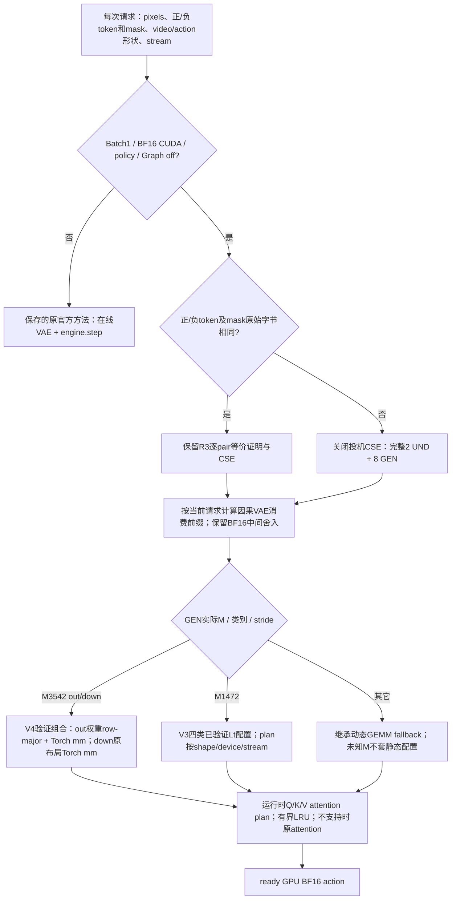

<!-- Archived report: paths and links adapted; see evidence/ORIGIN-MANIFEST.json. -->
# COSMOS3：从静态继承到动态实际执行

最终入口是 [candidate-full-port-v4.py](https://github.com/crycryout/ThorKDAWorkflow/blob/e52fa0107a4966712c4e8a2387150bb2e5b35dba/examples/cosmos3-nano-bf16-dynamic-full-port-20261024/solution/candidate-full-port-v4.py)。它每请求读取真实形状和内容，并保留原官方回退。这里列的是源码调用关系与已验证执行条件；性能结论以[正式报告](https://github.com/crycryout/ThorKDAWorkflow/blob/e52fa0107a4966712c4e8a2387150bb2e5b35dba/examples/cosmos3-nano-bf16-dynamic-full-port-20261024/reports/DYNAMIC-FULL-PORT.md)为准。

| 实际入口 | 实现位置 | 动态行为与证据 |
| --- | --- | --- |
| 最终V4层 | [candidate-full-port-v4.py](https://github.com/crycryout/ThorKDAWorkflow/blob/e52fa0107a4966712c4e8a2387150bb2e5b35dba/examples/cosmos3-nano-bf16-dynamic-full-port-20261024/solution/candidate-full-port-v4.py) | 仅添加M3542两类GEMM；每请求记录真实dispatch，不用enabled代替调用证据 |
| V3形状扩展 | [candidate-full-port-v3.py](https://github.com/crycryout/ThorKDAWorkflow/blob/e52fa0107a4966712c4e8a2387150bb2e5b35dba/examples/cosmos3-nano-bf16-dynamic-full-port-20261024/solution/candidate-full-port-v3.py) / [dynamic_lt_fallback_v3.py](https://github.com/crycryout/ThorKDAWorkflow/blob/e52fa0107a4966712c4e8a2387150bb2e5b35dba/examples/cosmos3-nano-bf16-dynamic-full-port-20261024/solution/dynamic_lt_fallback_v3.py) | M1472四类Lt；按M/N/K、stride、dtype、device、stream保护；未知shape原实现 |
| 动态诊断层 | [candidate-dynamic-v4.py](https://github.com/crycryout/ThorKDAWorkflow/blob/e52fa0107a4966712c4e8a2387150bb2e5b35dba/examples/cosmos3-nano-bf16-dynamic-full-port-20261024/solution/candidate-dynamic-v4.py) | 说明disabled CSE wrapper的0计数不代表实际算子没执行 |
| 不同CFG内容 | [candidate-dynamic-v3.py](https://github.com/crycryout/ThorKDAWorkflow/blob/e52fa0107a4966712c4e8a2387150bb2e5b35dba/examples/cosmos3-nano-bf16-dynamic-full-port-20261024/solution/candidate-dynamic-v3.py) | 比较token/mask原始byte；不相同则关闭算子memo，保留Lt、compact attention、rounded RMS及VAE |
| 官方回退与状态 | [candidate-dynamic-v2.py](https://github.com/crycryout/ThorKDAWorkflow/blob/e52fa0107a4966712c4e8a2387150bb2e5b35dba/examples/cosmos3-nano-bf16-dynamic-full-port-20261024/solution/candidate-dynamic-v2.py) | 初始化前保存原官方forward；Graph/Batch/rank/dtype/device/nonpolicy回退；最多2个Lt stream workspace；禁止同runner并发；close恢复方法 |
| 历史R3物理attention | [candidate-round3-v11.py](https://github.com/crycryout/ThorKDAWorkflow/blob/e52fa0107a4966712c4e8a2387150bb2e5b35dba/examples/cosmos3-nano-bf16-dynamic-full-port-20261024/solution/candidate-round3-v11.py) | 继承v9及v40精确PV144 correction，未采用历史失败v10或v41 |

两个不同的“长度”应分开：GEN M由视频patch及action长度决定；正负文本长度影响UND和GEN attention的KV。语言变化无需假装M也随之变化，反之改变视频/action也不能只检查文本shape。

不同CFG的正式每请求实际执行1次在线VAE、1次engine.step、2次condition encode及8次denoiser。1,152个GEN GEMM和288个attention由计数及独立native trace交叉核对。相同CFG的576/144复用只在其等价前提成立时使用，不能用于估算普通不同文本的收益。

支持按请求变化并不意味着每个形状都选用一个新kernel。M1982/M3526的新Lt完整模型实验退化或未复现，最终保留原动态实现；Graph只验证原官方兼容回退。并发使用独立runner，运行时换权重需重建control；本轮没有并发容量或自然语言/机器人任务成功率结论。

迁移合同与质量入口：[inherited-dynamic-contract-v1.json](https://github.com/crycryout/ThorKDAWorkflow/blob/e52fa0107a4966712c4e8a2387150bb2e5b35dba/examples/cosmos3-nano-bf16-dynamic-full-port-20261024/contracts/inherited-dynamic-contract-v1.json)、[最终25项质量](https://github.com/crycryout/ThorKDAWorkflow/blob/e52fa0107a4966712c4e8a2387150bb2e5b35dba/examples/cosmos3-nano-bf16-dynamic-full-port-20261024/results/candidate-gate-v4/validation.json)、[额外4项独立审核](https://github.com/crycryout/ThorKDAWorkflow/blob/e52fa0107a4966712c4e8a2387150bb2e5b35dba/examples/cosmos3-nano-bf16-dynamic-full-port-20261024/results/extra-main-independent-audit-v4.json)。完整历史读取行段和hash由[READ-PROVENANCE](https://github.com/crycryout/ThorKDAWorkflow/blob/e52fa0107a4966712c4e8a2387150bb2e5b35dba/examples/cosmos3-nano-bf16-dynamic-full-port-20261024/reports/READ-PROVENANCE.md)列出。
